# 4-Bit-Universal-Shift-Register
Implementation of 4 bit universal shift register in 45nm technology node in cadence.
# 4-Bit Universal Shift Register using Master-Slave D Flip-Flops and 4:1 Multiplexers
Full-custom, transistor-level design, simulation, layout and performance analysis of a 4-bit universal shift register (Hold, Shift Left, Shift Right, Parallel Load). Every block is built from individual transistors, from the inverter up to the complete register.
| Item | Value |
|------|-------|
| Tool | Cadence Virtuoso (Schematic Editor, ADE L, Layout Suite XL, Spectre, ViVA XL) |
| Technology | GPDK 45 nm (`g45n1svt` / `g45p1svt`, devices `nmos1v` / `pmos1v`) |
| Supply | VDD = 1 V |
| Transistor size (2:1 mux transmission gates) | W = 120 nm, L = 45 nm, m = 1 |
| Simulator / temperature | Spectre, 27 °C |
## Table of Contents
[Design Hierarchy](#design-hierarchy) · [Schematics](#schematics) · [Symbols](#symbols) · [Testbench](#testbench) · [Operating Modes](#operating-modes) · [Simulation Results](#simulation-results) · [Layouts, DRC and LVS](#layouts-drc-and-lvs) · [Performance Calculations](#performance-calculations) · [Summary of Results](#summary-of-final-results) · [Repository Structure](#repository-structure) · [Tools Used](#tools-used)
## Design Hierarchy
```
shift_register_tb
 └── shift_register
      ├── 4x1_mux  x4                  (one in front of every flip-flop)
      │    └── 2x1_mux  x3
      │         ├── not_gate  x1       (generates Sbar)
      │         └── transmission gate  x2  (1 PMOS + 1 NMOS each)
      └── msd_ff  x4                   (master-slave D flip-flop)
           ├── d_ff  x2                (master + slave)
           │    ├── nand_gate  x4
           │    └── not_gate   x1
           └── not_gate  x1            (inverts the clock for the slave)
```
Built bottom-up: inverter → NAND gate → D flip-flop → master-slave D flip-flop → 2:1 mux → 4:1 mux → universal shift register → testbench.

## Schematics
### 1. Inverter (`not_gate`)
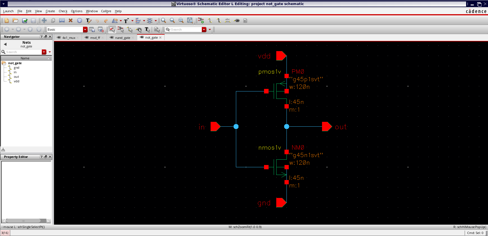

CMOS inverter made of one PMOS and one NMOS transistor. It is the basic block used in the NAND gate, the flip-flop, the clock inversion and the 2:1 mux select (`Sbar`).

### 2. NAND gate (`nand_gate`)
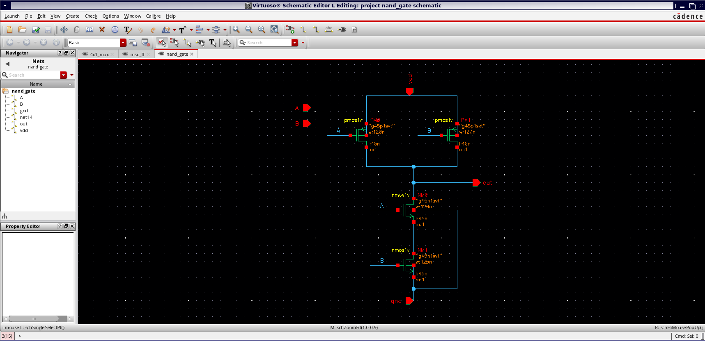

Transistor-level 2-input NAND gate. The output goes low only when both inputs are high. Four of these form the latch of each D flip-flop.

### 3. 2:1 Multiplexer (`2x1_mux`, transmission-gate based)
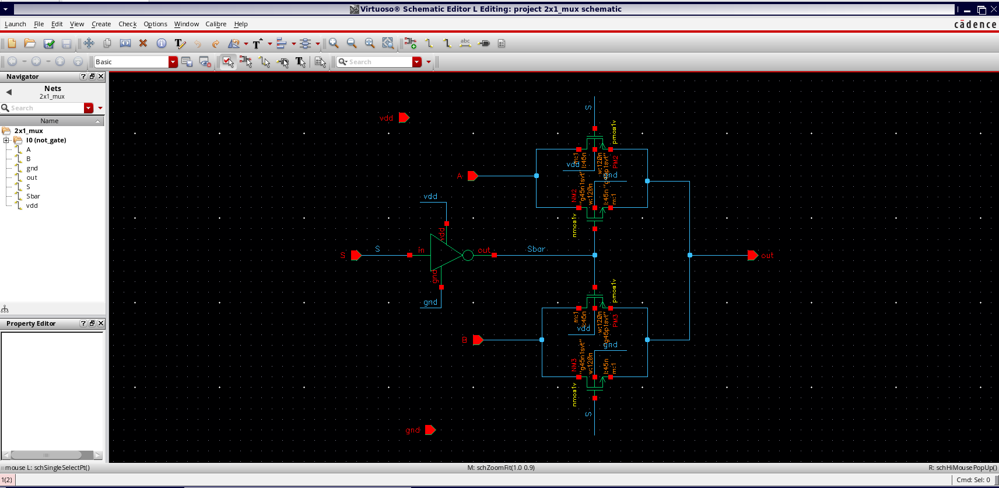

One inverter generates `Sbar` from `S`. Two CMOS transmission gates (PMOS + NMOS, W = 120 nm, L = 45 nm) are tied together at `out`.
- Input **A**: PMOS gate on `S`, NMOS gate on `Sbar`, so it conducts when **S = 0**.
- Input **B**: PMOS gate on `Sbar`, NMOS gate on `S`, so it conducts when **S = 1**.

| S | out |
|---|-----|
| 0 | A |
| 1 | B |

A transmission gate passes both logic 0 and logic 1 without a threshold drop.

### 4. 4:1 Multiplexer (`4x1_mux`)
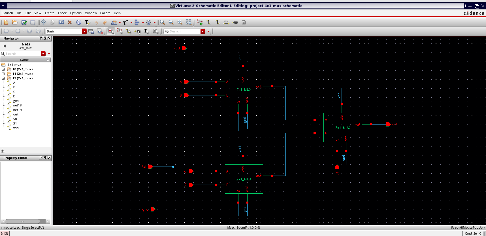

Three 2:1 muxes in a two-level tree. The first level (`I0`: A, B and `I1`: C, D) is driven by `S0`. The second level (`I2`) selects between them using `S1`.

| S1 | S0 | out |
|----|----|-----|
| 0 | 0 | A |
| 0 | 1 | B |
| 1 | 0 | C |
| 1 | 1 | D |

### 5. Master-Slave D Flip-Flop (`msd_ff`)
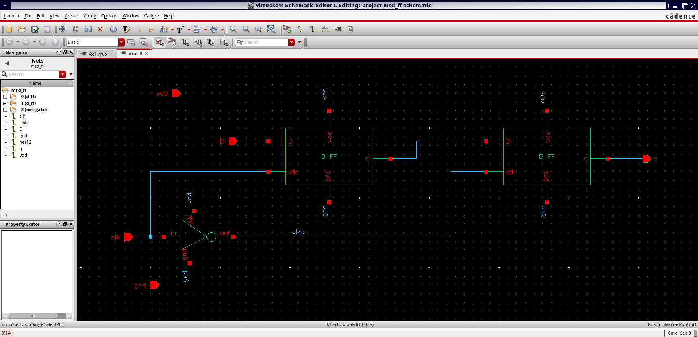

Two `d_ff` blocks are cascaded. The master receives `clk`, the slave receives the inverted clock `clkb` from an inverter, and the master `q` feeds the slave `D`. The master is transparent while the clock is high and the slave while it is low, so the output changes only on the **falling edge** of the clock (no race-through). Each `d_ff` uses four NAND gates (two gating NANDs and two cross-coupled latch NANDs) and one inverter.

### 6. 4-Bit Universal Shift Register (`shift_register`)
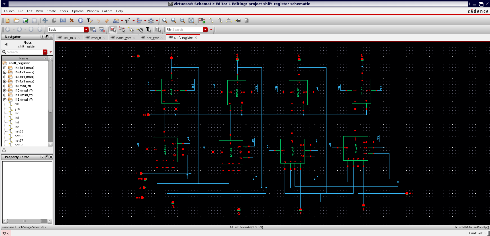

Four `msd_ff` flip-flops and four 4:1 multiplexers. Each multiplexer output drives the `D` input of one flip-flop and chooses between: its own output (hold), the neighbouring bit on one side (shift left, serial input `SISL`), the neighbouring bit on the other side (shift right, serial input `SISR`), and the parallel input `In0`–`In3`. All multiplexers share `S0`, `S1` and all flip-flops share `clk`.

**Ports:** inputs `In0`–`In3`, `SISL`, `SISR`, `S0`, `S1`, `clk`; outputs `P0`–`P3`; supplies `vdd`, `gnd`.

## Symbols
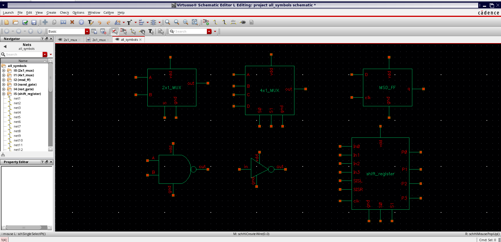

Symbols were created for the sub-circuits so they can be placed hierarchically in higher-level schematics.

## Testbench
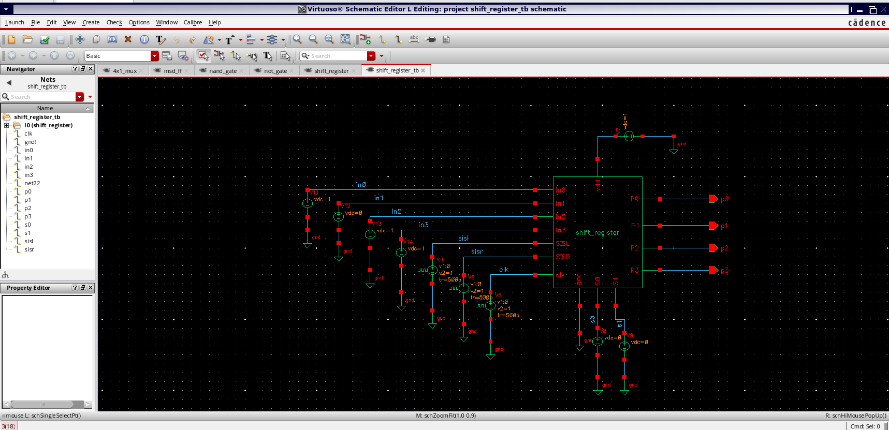

| Source | Instance | Value |
|--------|----------|-------|
| VDD | V7 | 1 V DC |
| In0 / In1 / In2 / In3 | V11 / V12 / V13 / V14 | 1 V / 0 V / 1 V / 1 V (DC) |
| SISL | V4 | pulse, 0 V to 1 V, tr = 500 ps |
| SISR | V5 | pulse, 0 V to 1 V, tr = 500 ps |
| clk | V6 | pulse, 0 V to 1 V, tr = 500 ps, **period = 20 ns** |
| S0 / S1 | V8 / V9 | DC, set per mode |

Transient analysis for 100 ns. The 20 ns period is read from the waveforms (falling edges at about 11, 31, 51, 71 and 91 ns).

## Operating Modes
| S1 | S0 | Mode | Behaviour |
|----|----|------|-----------|
| 0 | 0 | Hold | Each flip-flop reloads its own output |
| 0 | 1 | Shift Left | Data moves one bit left per falling clock edge, `SISL` enters |
| 1 | 0 | Shift Right | Data moves one bit right per falling clock edge, `SISR` enters |
| 1 | 1 | Parallel Load | `In0`–`In3` are loaded into `P0`–`P3` |

<!-- TODO: verify the S1 S0 codes for Shift Right and Parallel Load against your shift_register wiring. -->

## Simulation Results
All outputs change only on the **falling** clock edge, about 0.5 ns after it. The narrow spikes on `P0`–`P3` at every clock edge (a few mV up to about 16 mV) are **clock feedthrough**, not logic transitions.

| Hold | No Change |
|:---:|:---:|
| 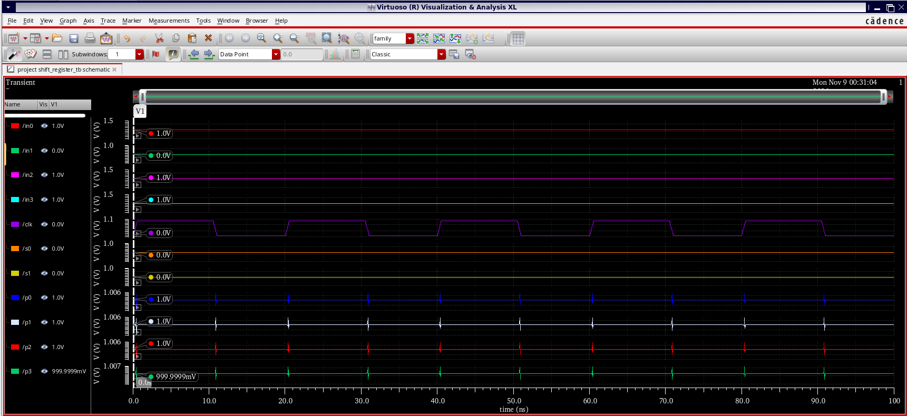 | 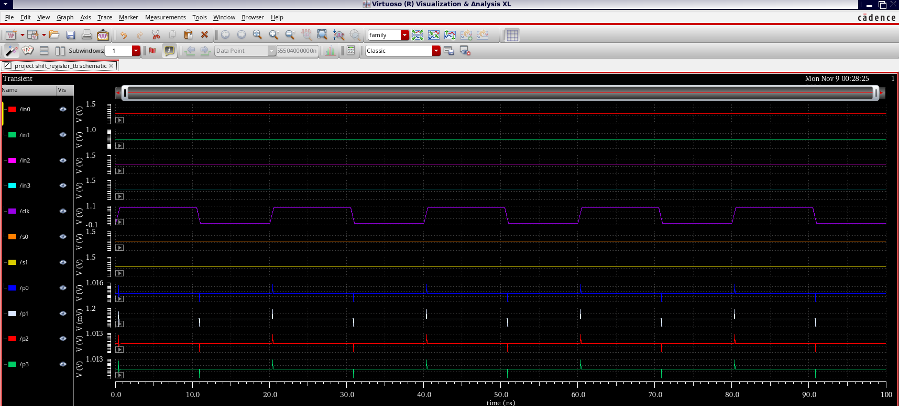 |
| `S1 = 0`, `S0 = 0`. `P0`–`P3` stay at logic 1 for the whole 100 ns while the clock runs. Only feedthrough spikes (about 6 mV) appear. | Outputs stay constant at logic 1 over the full run. Only feedthrough glitches (up to about 16 mV) appear, so no spurious transitions occur. |

| Shift Left | Shift Right |
|:---:|:---:|
| 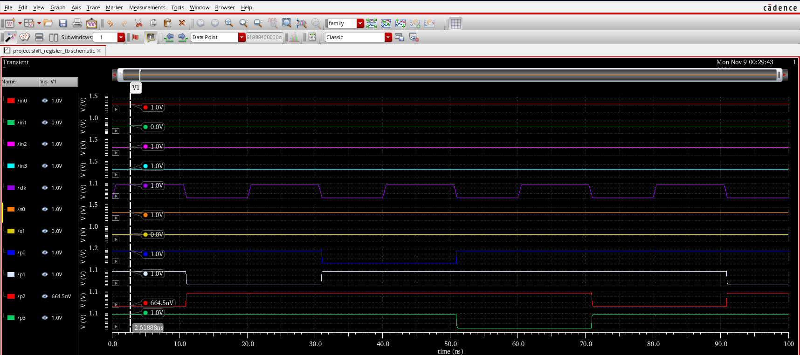 | 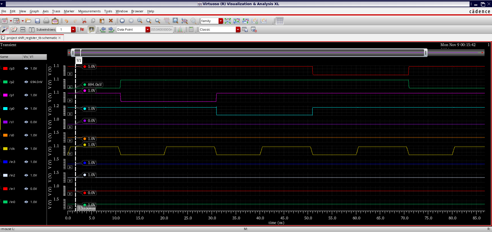 |
| `S1 = 0`, `S0 = 1`. After the 1st falling edge (about 11 ns) `P1` falls and `P2` rises. After the 2nd (about 31 ns) `P0` falls and `P1` rises. After the 3rd (about 51 ns) `P3` falls and `P0` rises. One position moves per falling edge. | Each falling clock edge moves the data by one position: `P2` rises at about 11 ns, `P1` falls at about 11 ns, `P0` falls at about 31 ns, `P3` falls at about 51 ns. |

<!-- TODO: the shift_right screenshot shows S1 = 0, S0 = 1 (same as shift_left) and identical waveforms. Re-run with the shift-right select code and replace the image if needed. -->

## Layouts, DRC and LVS
All layouts were drawn in Virtuoso Layout Suite XL using the GPDK 45 nm layers (Nwell, Poly, Pimp/Nimp, Metal1 and above, Cont, Vias). Each cell has a DRC screenshot, and the complete register also has an LVS screenshot.

**Inverter (`not_layout`)**

| Layout | DRC |
|:---:|:---:|
| 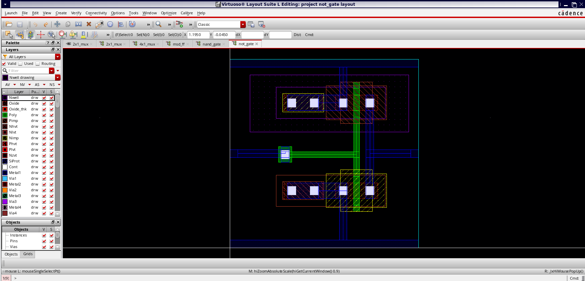 | 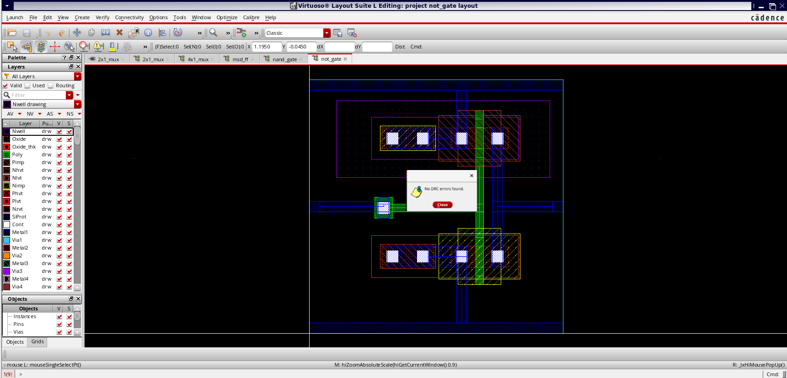 |

**NAND gate (`nand_layout`)**

| Layout | DRC |
|:---:|:---:|
| 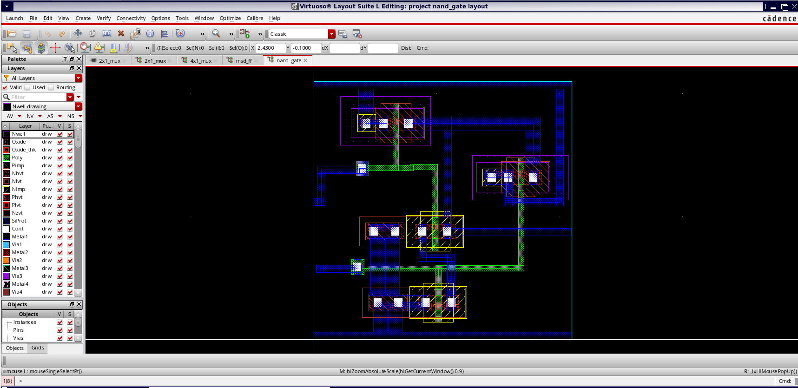 | 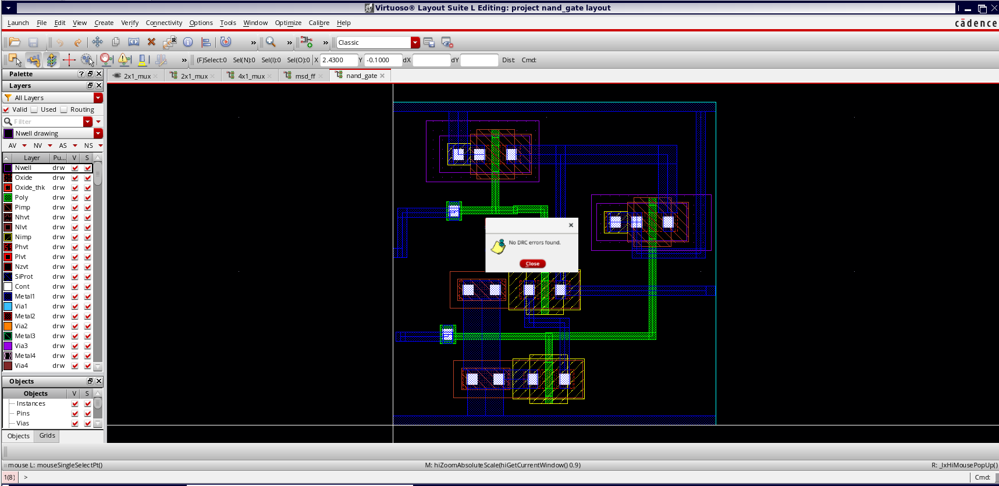 |

**2:1 Multiplexer (`2x1_mux_layout`)**

| Layout | DRC |
|:---:|:---:|
| 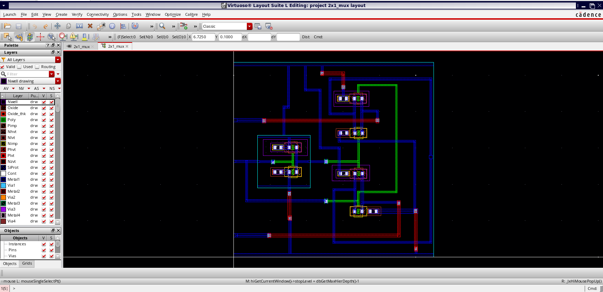 | 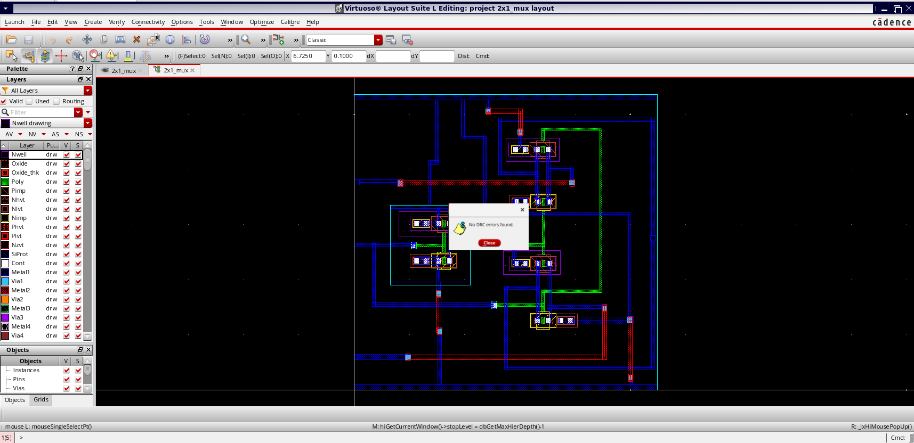 |

**4:1 Multiplexer (`4x1_mux_layout`)**: three 2:1 mux instances inside the PR boundary, two on the left (first level) and one on the right (second level). `S0` is shared by the first-level muxes and `S1` goes to the second-level mux.

| Layout | DRC |
|:---:|:---:|
| 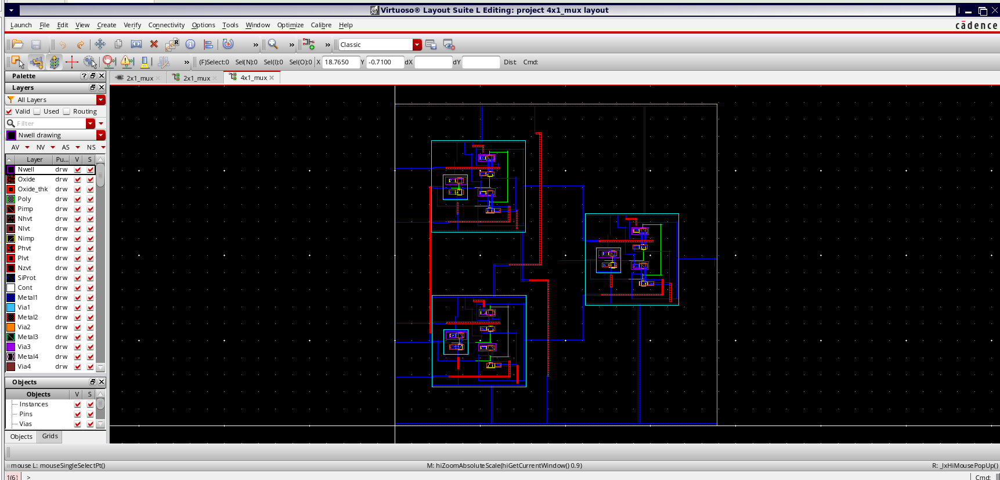 | 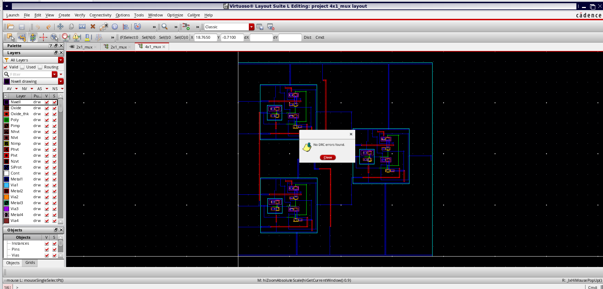 |

**Master-Slave D Flip-Flop (`d_flipflop_layout`)**: two `d_ff` instances side by side (left = master, right = slave), each with four NAND instances and one inverter. The inverter at the bottom left generates the inverted clock, and the master `Q` is routed to the slave `D`.

| Layout | DRC |
|:---:|:---:|
| 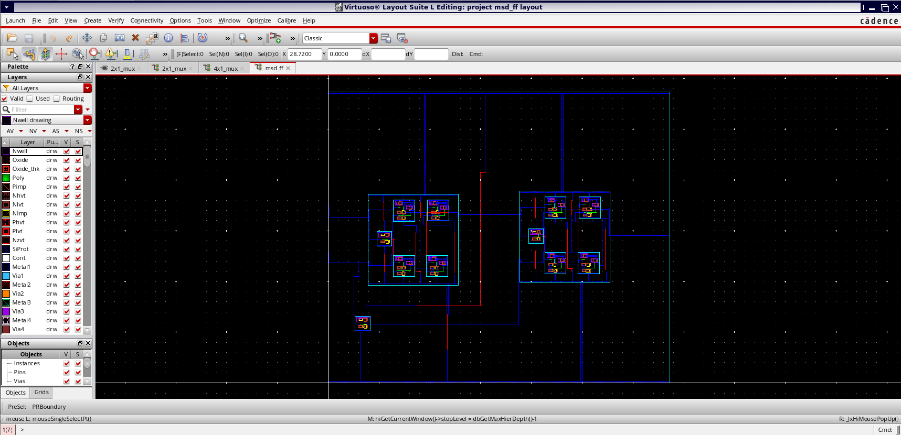 | 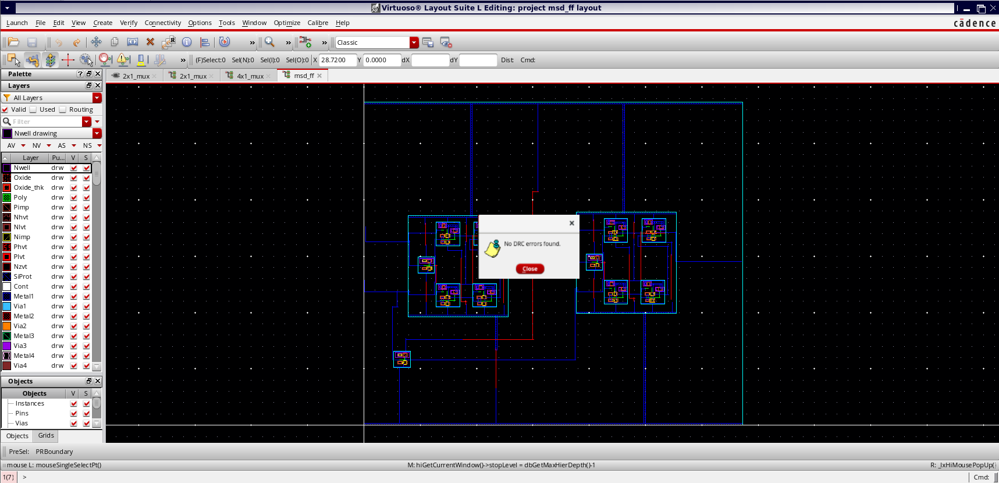 |

**Universal Shift Register (`universal_shift_register_layout`)**: the four flip-flop blocks are in a row at the top and the four 4:1 multiplexers in a row at the bottom. Vertical routing carries each multiplexer output up to its flip-flop `D` input, the flip-flop outputs return to the multiplexer inputs, and the select lines and clock run across all bit-slices.

| Layout | DRC | LVS |
|:---:|:---:|:---:|
| 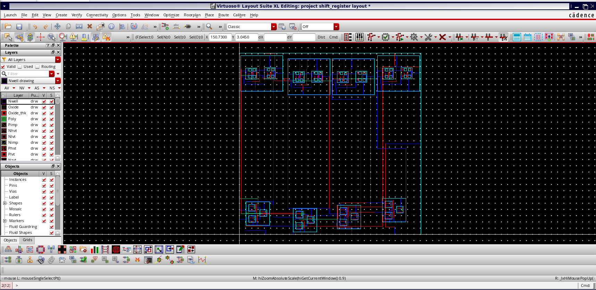 | 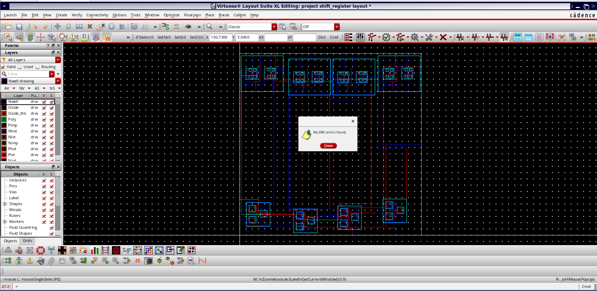 | 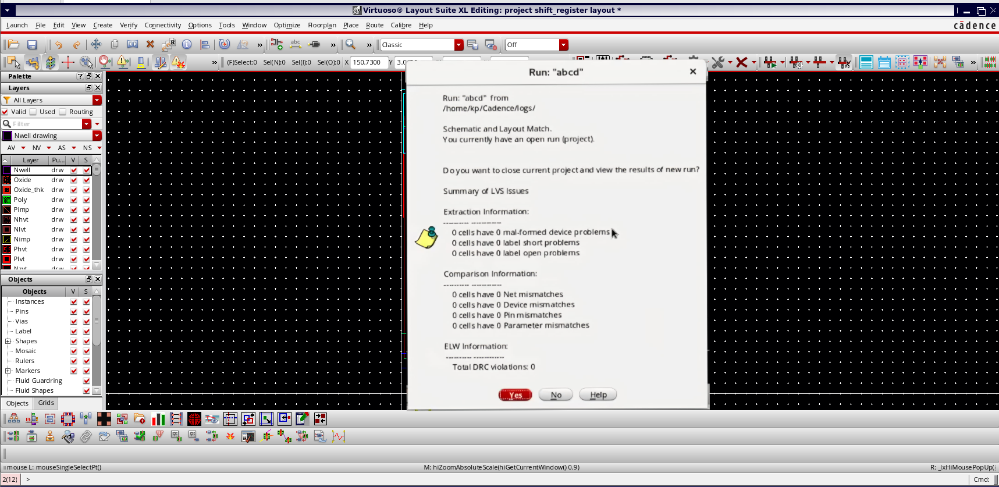 |

## Performance Calculations
Measured from the Spectre transient results using the Virtuoso ViVA calculator. For VDD = 1 V the thresholds are 10 % = 0.1 V, 50 % = 0.5 V, 90 % = 0.9 V.

### 1. Rise time and fall time (output `P0`)

```
t_r: cross(VT("/p0") 0.9 1 "rising"  nil nil) - cross(VT("/p0") 0.1 1 "rising"  nil nil)
t_f: cross(VT("/p0") 0.1 1 "falling" nil nil) - cross(VT("/p0") 0.9 1 "falling" nil nil)
```
| Rise time | Fall time |
|:---:|:---:|
| 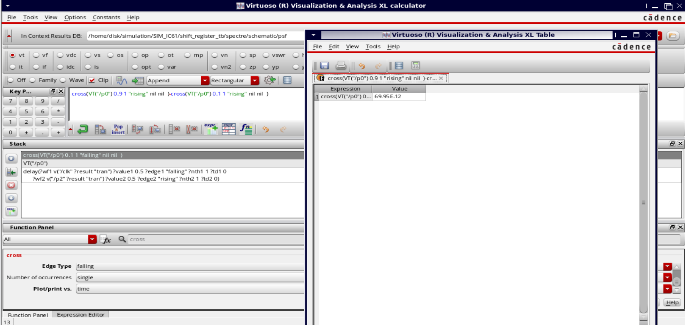 | 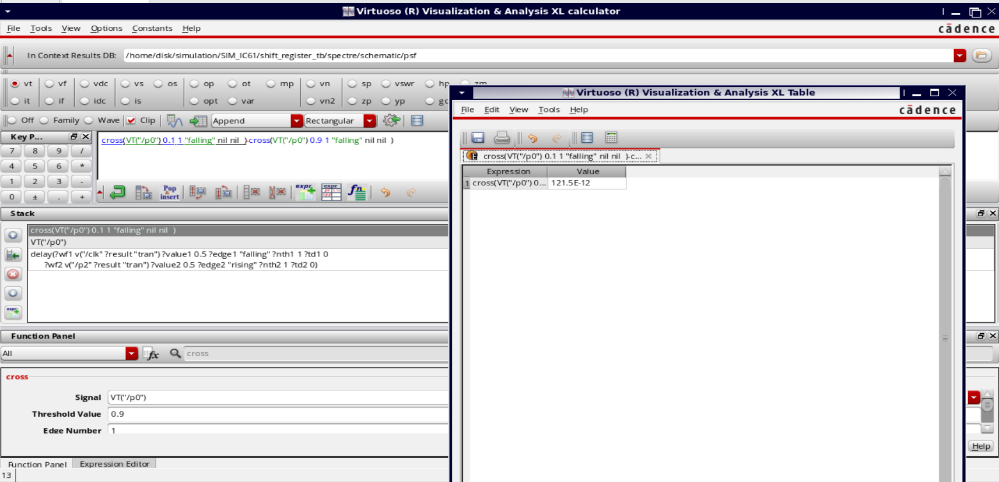 |

The fall time is about 1.74 times the rise time (121.5 / 69.95), so the pull-down edge is slower than the pull-up edge. Widening the NMOS devices of the output stage would balance them.
### 2. Propagation delay (t_PHL, t_PLH, t_pd)
For a flip-flop this is the **clock-to-Q delay**, from the 50 % point of the falling clock edge to the 50 % point of the output transition.
```
t_PHL = t50%(Q falling) − t50%(clk falling)
t_PLH = t50%(Q rising)  − t50%(clk falling)
t_pd  = (t_PHL + t_PLH) / 2
```
The outputs switch about 0.5 to 1 ns after the falling clock edge. The values below are **approximate estimates**: t_PLH is the measured 757.9 ps, and the slower fall edge adds about half of the edge-time difference to t_PHL.
```
t_PLH = 757.9 ps
t_PHL ≈ t_PLH + (t_f − t_r)/2 = 757.9 + (121.5 − 69.95)/2 ≈ 783.7 ps
t_pd  = (783.7 + 757.9)/2 ≈ 770.8 ps
```

### 3. Contamination delay (t_cd)
```
t_cd = min(t_PHL, t_PLH) = min(783.7 ps, 757.9 ps) ≈ 757.9 ps
```

### 4. Average power
```
P_avg = VDD × I_avg = 1 V × 631.2 nA = 631.2 nW ≈ 0.631 µW
```
```
average(-IT("/V7/PLUS"))      → I_avg = 631.2 nA
```
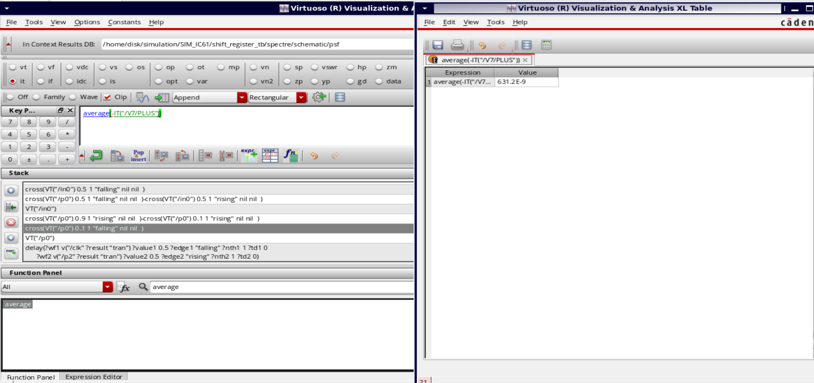

The minus sign is used because the current of a voltage source is defined into its `+` terminal. Energy per clock cycle (T = 20 ns):
```
E_cycle = P_avg × T = 631.2 nW × 20 ns = 12.62 fJ
```

### 5. Power-delay product and energy-delay product
```
PDP = P_avg × t_pd = 631.2 nW × 770.8 ps = 4.865 × 10⁻¹⁶ J ≈ 0.487 fJ
EDP = PDP × t_pd   = 0.487 fJ × 770.8 ps = 3.75 × 10⁻²⁵ J·s
```

### 6. Maximum clock frequency (rough estimate)
```
T_min ≥ t_cq + t_mux + t_setup + T_skew        f_max = 1 / T_min
```
Assumed: t_cq ≈ 0.77 ns (above), multiplexer delay ≈ 0.3 ns, setup time ≈ 0.2 ns, skew ≈ 0 (pre-layout).
```
T_min ≈ 0.77 + 0.3 + 0.2 ≈ 1.3 ns   →   f_max ≈ 1 / 1.3 ns ≈ 770 MHz
```
This is an order-of-magnitude estimate; the true value could lie between about 400 MHz and 1 GHz.
## Summary of Final Results
| Parameter | Formula | Result |
|-----------|---------|--------|
| Rise time t_r (P0) | t(90 %) − t(10 %) | **69.95 ps**  |
| Fall time t_f (P0) | t(10 %) − t(90 %) | **121.5 ps**  |
| Average supply current | average(−I(V7)) | **631.2 nA**  |
| Average power P_avg | VDD × I_avg | **631.2 nW** |
| Energy per cycle (T = 20 ns) | P_avg × T | **12.62 fJ** |
| t_PLH | clk 50 % → Q↑ 50 % | **757.9 ps** |
| t_PHL | clk 50 % → Q↓ 50 % | **783.7 ps**  |
| t_pd | (t_PHL + t_PLH) / 2 | **770.8 ps**  |
| t_cd | min(t_PHL, t_PLH) | **757.9 ps**  |
| PDP | P_avg × t_pd | **0.487 fJ**  |
| EDP | P_avg × t_pd² | **3.75 × 10⁻²⁵ J·s**  |
| f_max | 1 / T_min | **770 MHz**  |

## Repository Structure
```
.
├── README.md
├── schematics/
│   ├── not_gate.png
│   ├── Nand_gate.png
│   ├── 2x1_mux.png
│   ├── 4x1_mux.png
│   ├── D_flipflop.png
│   ├── shift_register.png
│   └── shift_register_tb.png
├── symbols/
│   └── all_symbols.png
├── layout/
│   ├── not_layout.png               ├── not_layout-drc.png
│   ├── nand_layout.png              ├── nand_layout-drc.png
│   ├── 2x1_mux_layout.png           ├── 2x1_mux_layout-drc.png
│   ├── 4x1_mux_layout.png           ├── 4x1_mux_layout-drc.png
│   ├── d_flipflop_layout.png        ├── d_flipflop_layout-drc.png
│   ├── universal_shift_register_layout.png
│   ├── universal_shift_register_layout-drc.png
│   └── universal_shift_register_layout-LVS.png
├── outputs/
│   ├── Hold.png
│   ├── No_change.png
│   ├── shift_left.png
│   └── shift_right.png
└── calculations/
    ├── rise_time.png
    ├── fall_time.png
    ├── average_power.png
    ├── delay.png
    ├── Tphl.png
    └── Tplh.png
```

## Tools Used
Cadence Virtuoso Schematic Editor · Layout Suite XL · ADE L with Spectre (transient analysis) · Virtuoso Visualization & Analysis XL (waveforms and calculator) · GPDK 45 nm process design kit
Author<br>
**K.Karthikeya**<br>
Department of ECE,IIITDM Kurnool<br>
**Under the Guidance of:-** <br>
**Dr.P.Rangababu**<br>
Associate Professor, Department of ECE, IIITDM Kurnool
